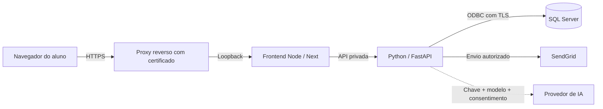

# Hospedagem na Hostinger

Guia de arquitetura preparado em 03/11/2026. A instalação foi posteriormente autorizada e publicada em <https://srv1834976.hstgr.cloud>. Consulte [PUBLICACAO_HOSTINGER.md](PUBLICACAO_HOSTINGER.md) para o estado executado, os comandos operacionais e as limitações. As etapas abaixo servem de referência para novas instalações.

## Arquitetura proposta

O painel da conta precisa ser inspecionado para escolher um recurso existente. A Hostinger informa que Python requer VPS; um plano somente de hospedagem web não executa sozinho a API deste projeto. Não substituir SQL Server por MySQL/PostgreSQL nem contratar um plano sem decisão do responsável.

Fonte consultada: [linguagens e frameworks suportados pela Hostinger](https://www.hostinger.com/support/which-programming-languages-and-frameworks-are-supported-at-hostinger/).

## Preparação já disponível

No frontend, `pnpm run build:hostinger` gera `.next-hostinger/standalone`. `pnpm run start:hostinger` copia `public` e `.next-hostinger/static` e inicia o servidor Node. A validação local utiliza a mesma distribuição.

Configurações do frontend, somente no servidor:

| Variável | Valor esperado |
| --- | --- |
| `EDUTRACK_API_URL` | `http://127.0.0.1:8000` se os processos estiverem na mesma VPS, ou URL HTTPS privada apropriada |
| `EDUTRACK_SITE_URL` | Origem pública HTTPS exata, sem caminho, consulta ou fragmento |
| `PORT` | Porta interna reservada para este projeto |
| `HOSTNAME` | `127.0.0.1` atrás de proxy reverso local |

Backend: usar a fábrica `edutrack.main:app_factory`, por exemplo com `uvicorn --factory edutrack.main:app_factory --host 127.0.0.1 --port 8000 --workers 1 --no-access-log --no-proxy-headers`, em um serviço supervisionado e usuário dedicado. Esse comando é uma referência; não foi executado na VPS.

Segredos da API ficam fora do Git: `EDUTRACK_JWT_SECRET`, `EDUTRACK_DATABASE_URL`, `SENDGRID_API_KEY`. Definir `EDUTRACK_ENVIRONMENT=production`, certificado SQL confiável, origens CORS HTTPS exatas e `EDUTRACK_FRONTEND_URL` com a URL HTTPS do site. Ativar gravação e recuperação somente após provisionamento e conferência do schema. Credenciais de desenvolvimento não devem ser reutilizadas em produção.

O limitador atual e as tarefas de e-mail estão na memória de um processo. Manter uma única instância inicialmente; múltiplos workers exigem Redis/limitador compartilhado e fila persistente antes de escalar. O proxy deve acrescentar proteção de abuso. O backend não deve aceitar cabeçalhos de origem de clientes não confiáveis.

## Passos restantes e critérios de aprovação

1. Concluir login na conta Hostinger e identificar VPS/plano/domínios existentes, sem alterar serviços.
2. Conferir sistema, recursos, portas e aplicativos em uso; preparar local, serviço e rollback separados para EduTrack.
3. Escolher URL sem custo adicional: preferir subdomínio de um domínio já pertencente ao usuário, se houver. Endereço temporário do provedor depende do produto disponível. Não prometer domínio gratuito antes dessa conferência.
4. Definir hospedagem do SQL Server e backup. O SQL Server Express instalado no computador não estará acessível pela VPS por `localhost`; não abrir a porta do banco à internet como atalho.
5. Apresentar destino, serviços, DNS/certificado, dados que serão transferidos e custo, se existir. Obter a confirmação exigida pelo AGENTS.md antes de modificar infraestrutura.
6. Implantar, executar `/ready`, verificar login, cookies HTTPS, recuperação por e-mail, CRUD isolado, relatórios e Swagger. A criação de dados de teste no banco de produção exige autorização própria.
7. Conferir URL pública e rollback; só então atualizar os links da entrega.

O Swagger está desativado por padrão em produção. Para a apresentação, use o Swagger local em `http://127.0.0.1:8000/docs` ou o contrato salvo em `edutrack-api/docs/openapi.json`. Uma futura disponibilização na VPS exige configuração explícita e acesso restrito; apenas um túnel não ativa uma rota desabilitada. Não expor banco ou segredos para viabilizar a apresentação.

GitHub armazena código e executa CI; GitHub Pages estático não substitui os processos Node, Python e SQL Server.

