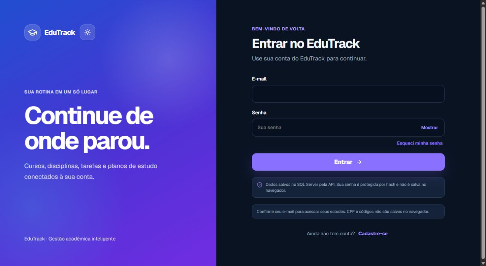

# Publicação do EduTrack — 03/11/2026

Site: <https://srv1834976.hstgr.cloud>. Login: <https://srv1834976.hstgr.cloud/login>.

A implantação foi autorizada pelo responsável, incluindo os termos Microsoft, o banco vazio, HTTPS e transferência da credencial SendGrid por SSH. Não houve compra, alteração de DNS ou cópia dos dados acadêmicos do computador. O endereço Sites antigo permanece separado.

## Instalação conferida

- VPS `srv1834976`, projeto Docker `edutrack`, frontend Next/Node, FastAPI/Python e SQL Server 2022 **Express**.
- Frontend e API compilados no Linux. Imagens-base oficiais fixadas por digest nos Dockerfiles/Compose.
- Banco `EduTrackIA` novo, com nove tabelas e login `edutrack_app` com SELECT, INSERT, UPDATE e DELETE somente nessas tabelas, sem DDL.
- Banco em `127.0.0.1:14330`, API em `127.0.0.1:8000`, frontend em `127.0.0.1:3002`; somente Nginx recebe acesso público.
- Certificado Let's Encrypt emitido, com vencimento inicial em 02/02/2027. Nginx validado antes da recarga.
- SQL com TLS obrigatório. ODBC valida cadeia e hostname; `TrustServerCertificate=no`. As CAs intermediárias foram verificadas contra as raízes do sistema e fornecidas ao cliente, pois a cadeia completa não chegou inicialmente pelo SQL.
- `/ready` respondeu `200` e `status=ok`. API e frontend estão saudáveis no Docker.
- Login, cadastro e recuperação responderam `200` por HTTPS e foram abertos no Chrome. As opções públicas confirmam verificação por e-mail, remetente configurado e recuperação habilitada.
- CRM permaneceu com seus containers originais saudáveis e URL respondendo `200`. Serviço de envio de leads permaneceu ativo. Arquivos Nginx anteriores não foram modificados.

## Contas, e-mail e IA

O banco público começou vazio. **As contas locais não foram migradas:** cadastre sua conta no endereço novo. Nenhuma conta de administrador foi criada automaticamente nesta implantação.

SendGrid foi configurado por arquivo privado (`0600`), sem imprimir ou publicar a chave. Não foi enviado um e-mail real nem executado CRUD com conta real na VPS nesta validação. Esses fluxos passaram em testes isolados; o primeiro cadastro real e recebimento de e-mail devem ser conferidos pelo titular.

A Edu IA oferece planejamento por regras usando os dados da própria conta. A integração generativa está preparada, mas continua sem chave/modelo e sem chamadas pagas.

## Operação e backup

- Código instalado em `/opt/edutrack/releases/edutrack-entrega-final-20261103-221124`; `/opt/edutrack/current` aponta para essa versão.
- Segredos em `/opt/edutrack/secrets`, fora do código e do GitHub. Chaves SQL têm permissão `0440`, restritas ao usuário do SQL.
- Backup SQL nativo com checksum e `RESTORE VERIFYONLY` foi executado com sucesso. Isso verifica integridade do arquivo; não substitui um ensaio de restauração em outra instância.
- `edutrack-backup.timer` agenda backup diário às 04:15, com até cinco minutos de variação, no fuso da VPS. Backups ficam no volume SQL e em `/opt/edutrack/backups/sql`, protegidos e sem exclusão automática. Acompanhar o uso de disco e definir retenção/off-site antes do uso contínuo com alunos.
- O Certbot mantém renovação automática. O hook exclusivo `edutrack` valida a cadeia, atualiza cópias privadas, reinicia somente SQL/API do EduTrack e recarrega Nginx após teste. A renovação futura e o hook ainda não foram exercitados por uma renovação real; podem causar breve indisponibilidade do EduTrack.
- O Swagger continua **local**: <http://127.0.0.1:8000/docs>, com API local ligada. `/docs` e `/openapi.json` ficam desativados na API de produção. O contrato também está em `edutrack-api/docs/openapi.json`.

## Atualização e reversão

Antes de atualizar: revisar fontes, testes, migrações e backup; obter aprovação para qualquer nova alteração crítica. Não executar `docker compose down -v`.

O projeto é iniciado por `docker compose --env-file /opt/edutrack/secrets/compose.env -f /opt/edutrack/current/deploy/hostinger/compose.yaml`. Sempre limitar comandos a esse arquivo/projeto. Não imprimir a configuração resolvida: ela contém segredos.

Para desativação autorizada, parar somente `web` e `api` do EduTrack e desabilitar somente `/etc/nginx/sites-enabled/edutrack`, testando Nginx antes da recarga. Preservar SQL, volume, certificados e backups. Os demais sites devem continuar funcionando.

## Entrega acadêmica

Código, documentação `.md`, OpenSpec e testes pertencem à pasta `2-semestre/Projeto Final` do repositório `antoniobrites/Faculdade-Impacta`. O workspace local `EduTrack.code-workspace` continua apontando para as fontes completas em `work/`.

Vídeos da avaliação ainda precisam ser gravados; o roteiro está em [ROTEIRO_AVALIACAO_FINAL.md](ROTEIRO_AVALIACAO_FINAL.md). Publicação e roteiro não equivalem a envio da avaliação ao Classroom.

Referência para TLS: [Microsoft — conexões criptografadas no Linux](https://learn.microsoft.com/en-us/sql/linux/security/encrypted-connections?view=sql-server-ver17).
