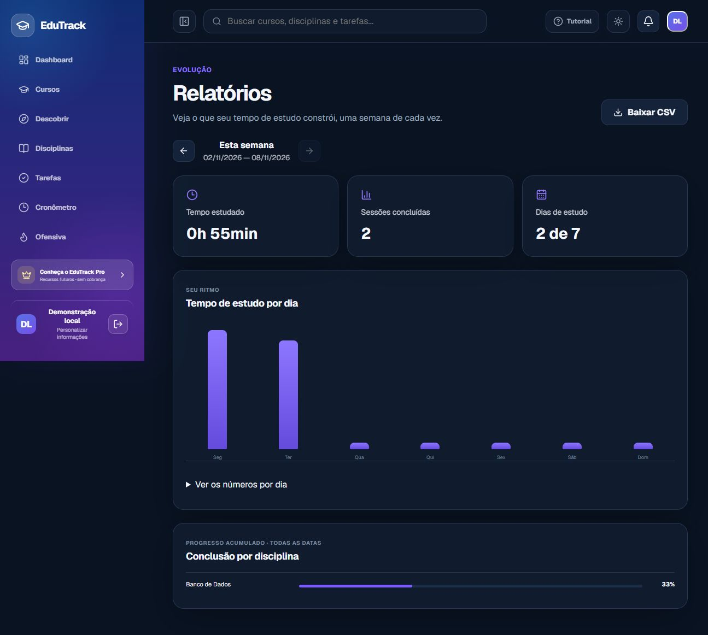
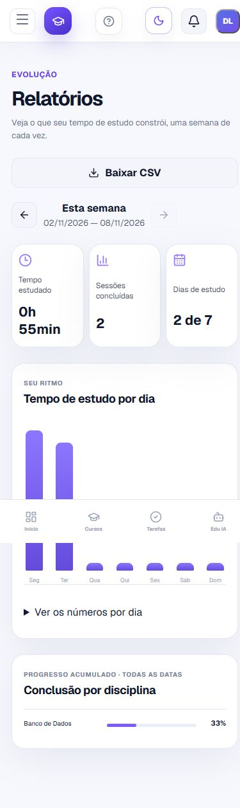
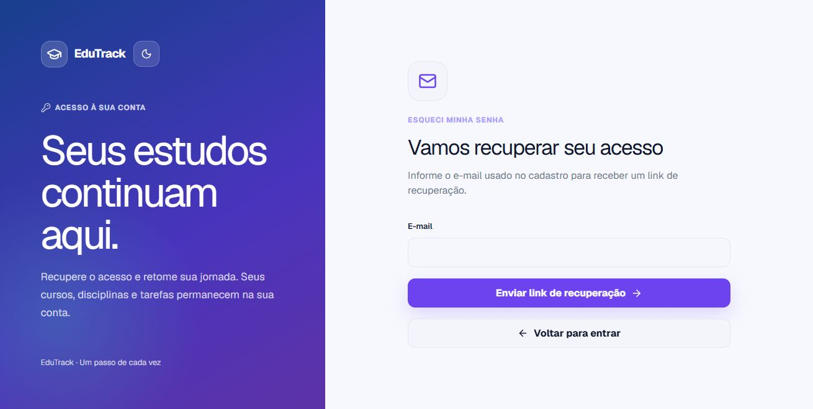

# Validação da entrega — 03/11/2026

## Resultados confirmados

| Verificação | Resultado | Limite da evidência |
| --- | --- | --- |
| API Python | 92 testes aprovados | SQLite descartável; envio de e-mail e IA substituídos por testes controlados |
| Interface e regras TypeScript | 39 testes aprovados | Inclui autenticação no proxy, isolamento, calendário, ofensiva, exclusão e relatórios |
| TypeScript | Sem erros | Conferido também após alternar Next e Vinext |
| ESLint | Sem erros ou avisos | Código do frontend, testes e scripts; saídas geradas ignoradas |
| Ruff | Sem erros | Backend, scripts e testes |
| OpenSpec | 7 itens aprovados | 6 especificações e 1 mudança, modo estrito |
| Build Node | Compilação concluída em Next 16.4.5 | Saída `.next-hostinger`, separada dos tipos Vinext em `.next` |
| Dependências de produção do frontend | Auditoria sem vulnerabilidades conhecidas | Resultado da consulta ao registro nesta data; não substitui auditoria de segurança completa |
| SQL Server local | 9 tabelas conferidas por leitura | Migração 003 autorizada aplicada; quantidades anteriores preservadas |
| OpenAPI | 23 caminhos documentados | Contrato atualizado em `edutrack-api/docs/openapi.json`, incluindo recuperação |
| Chrome desktop | Login, navegação e relatórios funcionaram | Conta e atividades fictícias em prévia descartável |
| Chrome mobile | 390 × 844, temas claro e escuro | Relatório sem transbordamento horizontal; viewport restaurado ao final |
| CSV | Download e conteúdo conferidos | Sete dias; 30 + 25 = 55 minutos e 2 sessões, igual à tela |
| Planejador | 5 blocos para tarefas pendentes da conta | Regras locais, sem chamada a modelo de IA e sem alterar tarefas |
| Recuperação real local | Tela habilitada e conectada à API/SQL Server | Nenhum e-mail novo enviado e nenhuma senha real redefinida nesta etapa |
| Hostinger | Implantação autorizada, compilada e publicada | HTTPS, login/cadastro/recuperação `200`, API `/ready` saudável; CRM preservado |
| Docker Compose | Três serviços EduTrack em execução | SQL Server Express, API e frontend isolados; API e web saudáveis |
| Backup SQL | Backup nativo com checksum e VERIFYONLY | Integridade conferida; timer diário ativo; restauração em instância separada ainda não exercitada |

A atualização do Next e de `source-map-js` corrige os alertas de dependências encontrados. As versões estão travadas no `pnpm-lock.yaml`. A prévia visual usa SQLite temporário com conexões independentes para suportar as leituras simultâneas do dashboard; o banco real permanece SQL Server.

Um aviso de depreciação do TestClient/HTTPX foi emitido pela dependência Python, sem falhas nos testes. Atualização futura deve seguir a compatibilidade do FastAPI/Starlette.

## Requisitos da avaliação

| Requisito | Situação atual |
| --- | --- |
| Login, cadastro e esqueci minha senha | Implementados, testes automáticos e tela local conferidos |
| Disciplinas e tarefas | API/CRUD implementados; cobertura automatizada de permissões e vínculos |
| Relatório | Semanas reais, navegação, tabela e CSV implementados e conferidos |
| IA | Planejamento por regras funciona; conversa generativa depende de chave/modelo ainda não fornecidos |
| Banco e modelo | SQL Server local e banco novo na VPS, DER, dicionário, schema completo e migrações disponíveis |
| GitHub, estrutura, programas e OpenSpec | Fontes organizadas e OpenSpec validado; entrega em `Faculdade-Impacta/2-semestre/Projeto Final` |
| Vídeos de apresentação | Roteiro em três partes pronto; vídeos não gravados nem entregues nesta etapa |
| Publicação nova | <https://srv1834976.hstgr.cloud>, conferida por HTTPS e Chrome após aprovação |

## Evidências visuais locais

As imagens abaixo mostram dados fictícios de teste, exceto a tela de recuperação, que está conectada ao ambiente real local e não contém informações preenchidas.

As capturas locais acima não comprovam publicação. A publicação possui evidência e limitações próprias em [PUBLICACAO_HOSTINGER.md](PUBLICACAO_HOSTINGER.md). Não houve submissão ao Classroom. O primeiro cadastro real, envio/recebimento de e-mail e CRUD autenticado na VPS ainda precisam ser conferidos pelo titular; não confundir os testes isolados com esse uso real.
